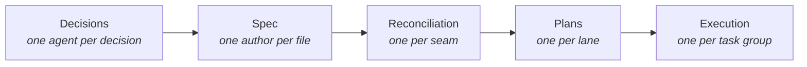
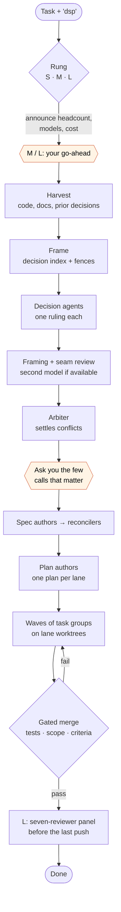
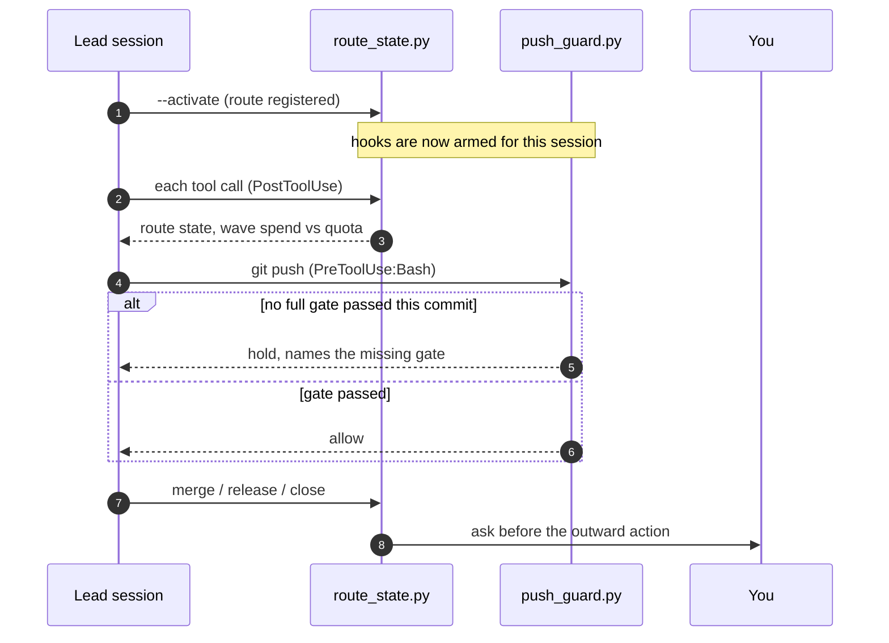

<div align="center">

# decision-spec-plan

**Evidence-based gates for multi-agent Claude Code work.**

[](https://github.com/Wintersta7e/decision-spec-plan/actions/workflows/ci.yml)
[](LICENSE)
[](#install)
[](skills/decision-spec-plan/scripts)
[](#requirements)

[What it checks](#what-it-checks) · [Is it worth it](#is-it-worth-it) · [How a route runs](#how-a-route-runs) · [Hooks](#hooks) · [Cost](#cost) · [Install](#install) · [Development](#development)

</div>

---

## What it checks

Agents report "tests pass" and "done". This plugin makes those claims checkable, from git and files
rather than from the agent's word:

- **No push without a passing gate.** Git's pre-push hook holds any commit that has no gate log
  showing that exact commit, on a clean tree, passing the full gate. `gate.py` runs the gate and
  writes that log itself, so it cannot lose its exit status to a pipe or be edited green.
- **No green gate bought by deleting tests.** `test_check.py` lists the acceptance tests a lane
  deleted, skipped, weakened or edited after they were written.
- **No spend past what you agreed.** A wave of agents waits until its budget is recorded and you
  have answered; past 125% of it, it asks again.
- **No outward action without you.** Merges, releases and other writes to the hosted repository are
  asked for each time, and agents may not run them.
- **Stage checkers** for the documents in between: every decision's sources, every acceptance
  criterion mapped to a task and a test file, every planned file traced to something you asked for.

What each check proves, and what it does not, is in
[`references/gates.md`](skills/decision-spec-plan/references/gates.md).

The checks come with a reference workflow, the **route**, that uses all of them. Hand Claude a bug,
a bug hunt, an investigation, a feature, a review or a whole phase, and say
**"dsp"** ("use dsp", "dsp this"). The session becomes the **lead** (the route's other terms:
[`references/glossary.md`](skills/decision-spec-plan/references/glossary.md)). It frames the work, verifies
every code claim before ruling on it, dispatches agents and arbitrates where their work meets. It
does not write the decisions, specs or plans itself.

> **Why it is built this way:** about 40 agents partitioned by spec section left **105**
> cross-section contradictions. About 10 agents partitioned by decision, with an arbiter settling
> the seams, left **1**. That is two phases of one project with different agent counts, an
> observation rather than a controlled comparison (`failure-modes.md` F1).

The unit of work changes with the stage, so no two agents ever own the same question:



## Is it worth it

Not for a small, clear task, if cost is what you measure. On one rung-S build, run once each in the
same container, plain Claude Code cost **0.36×** the route ($7.29 against $20.32) in **0.26×** the
time (19 against 72 minutes), and both passed the project's gate. Against 15 hidden acceptance
scenarios the route's branch had **4** defects and plain Claude's **7**: plain Claude merged two
people who share a name, and treated a different note or local date at the same minute as a
duplicate. A second route build of the same task cost $18.05 in 68 minutes and had **5** defects.
An earlier pair, with an older version of the plugin, found the same name merge at 0.65× the cost.
That is one task, two route runs and one plain run, an observation rather than a benchmark
(`costs.md`, `failure-modes.md` F85).

Use plain Claude for one obvious fix. Use the route when there are open design decisions, when
several agents will build in parallel, or when you want every push and every merged lane checked.

## How a route runs



<sub>The full route, as run at rung L. Shaded steps wait for you. At rung S the lead writes the
decisions, spec and plan itself, and one second-model review replaces the agents, reviews and
arbiter.</sub>

| Rung | When | Shape |
|---|---|---|
| **S** | 1–3 open decisions, and any PR review | The lead writes one decision document, one spec and one plan; fresh agents execute; one second-model review |
| **M** | 4–7 decisions, or fewer needing several plans | Harvest inline or by one agent, 2–4 spec authors, reconciliation |
| **L** | 8+ decisions, several subsystems | The full route, including the seven-reviewer panel |

One rung-S route from a real run, from the task to the gated branch, is walked through in
[`references/worked-example.md`](skills/decision-spec-plan/references/worked-example.md).

Questions reach you in one batch, at most four at a time. The recommended option comes first, and
every option states its consequence.

## Hooks

While the plugin is enabled, its hooks load in **every** session but act only in a session that ran
`route_state.py --activate`. Any other session pays about 0.02 s per tool call.



| Hook | Event | Holds or reports |
|---|---|---|
| `push_guard.py --pre-push` | git's `pre-push`, written into the repository by `--activate` | A push of any commit that no full gate passed, read from the exact refs git sends |
| `push_guard.py` | PreToolUse:Bash | A push that would skip the git hook (`--no-verify`); a bypass (`DSP_SKIP_*`), which you approve and agents may not use; every push, where the repository's hooks live elsewhere (`core.hooksPath`) |
| `route_state.py --hook` | PreToolUse, PostToolUse, UserPromptSubmit, SessionStart, SubagentStop, TeammateIdle | Route state and wave spend; outward actions held for your answer; hand-written gate logs refused; an agent stopping while its own background jobs still run |

The guards target careless agents, not adversaries:
[`references/gates.md`](skills/decision-spec-plan/references/gates.md) says what each check
establishes, what it does not, and what happens when a hook fails. The stage checkers (`plan_lint.py`,
`scope_check.py`, `criteria_check.py`, `decision_check.py`, `test_check.py`) are not hooks. The lead
runs them at each gate; `test_check.py`, for example, flags acceptance tests that were deleted,
skipped or edited after they were written. Every gate runs through `gate.py`, which writes the log
the push checks read: the commit, whether the tree was clean, the command, its output and its exit
status.

## Cost

> [!WARNING]
> Routes are expensive. These are measured on real routes, in millions of Opus input-equivalent
> tokens (M): 1M is about $4 at API prices (read 2026-10-17). On a subscription they count against
> your usage limits, which routes running at once share.

| Route | Typical |
|---|---|
| Rung S review of a merge request | 1.6–10.8M (median ≈ 2.6–4.2M) |
| Rung S build, with execution | 5.7–6.7M |
| Execution task group | median ≈ 1.0M |
| Lead at rung M or L | 5–35M (one three-phase session reached 66M) |

[`references/costs.md`](skills/decision-spec-plan/references/costs.md) has the full table. The lead
prices every stage from these figures, or from your project's own medians once it has run a route,
and asks before spending at M and L.

## Install

From this repository as a marketplace:

```
/plugin marketplace add Wintersta7e/decision-spec-plan
/plugin install decision-spec-plan@decision-spec-plan
```

Each release bumps the plugin's version and is listed in [`CHANGELOG.md`](CHANGELOG.md). Claude
Code updates an install only when that version changes. To take a release, run
`claude plugin marketplace update decision-spec-plan`, then
`claude plugin update decision-spec-plan@decision-spec-plan`. To have it done for you, turn on
auto-update for the marketplace under `/plugin` → Marketplaces.

Start a new session afterwards, because hooks load at session start. Then add to
`~/.claude/settings.json`:

```json
{
  "env": { "CLAUDE_CODE_EXPERIMENTAL_AGENT_TEAMS": "1" },
  "modelSettings": { "claude-opus-5-5": { "autoCompactWindow": 300000 } }
}
```

| Setting | Why |
|---|---|
| `CLAUDE_CODE_EXPERIMENTAL_AGENT_TEAMS=1` | Required: the route dispatches agent teams |
| `autoCompactWindow: 300000` for the lead's model | Without it, leads grew to about 965k context, where each turn costs about 0.1M |
| `CLAUDE_CODE_PRINT_BG_WAIT_CEILING_MS=0` | Headless runs (`claude -p`) only: keeps background agents alive while the lead waits |

[`INSTALL.md`](INSTALL.md) covers a manual install into the skills directory, upgrades and the MCP
tool list in the agent files.

### Requirements

- Claude Code with plugin support
- Python 3.11+, `bash` and `git`
- Optional: `systemd-run --user` for the execution agents' memory cap; without it they fall back to
  `timeout` and `setsid`
- Optional: a second model for cross-model review; without one, a Claude agent does the review

Developed and tested on Linux (WSL2). macOS and native Windows are untested.

## Layout

```
skills/decision-spec-plan/
├── SKILL.md              the lead's instructions (kept under 19,000 characters)
├── agents/               dsp-deep (the session's model) and dsp-mechanical (Sonnet, medium effort)
├── references/           briefs, prompts, templates, costs, execution, the failure-mode log
├── scripts/              hooks and stage checkers (Python, standard library only)
├── hooks/hooks.json      hook wiring
└── tests/                pytest suite (dev-only packages), run against throwaway repositories
```

[`references/failure-modes.md`](skills/decision-spec-plan/references/failure-modes.md) records each
failure seen in real routes and the rule it produced. When an agent pushes back on a rule, the
evidence for that rule is in this log.

## Development

```
pip install -r requirements-dev.txt   # the pinned tools; the plugin itself needs none
make check                            # format, lint, types, architecture, dead code, tests
python3 -m pytest skills/decision-spec-plan/tests   # the suite alone; tests the copy it sits in
```

The suite builds throwaway repositories and points `HOME` at a temp directory, so it never touches
your projects or your Claude configuration. CI runs the same commands on every push and pull
request.

## License

[MIT](LICENSE) © 2026 Wintersta7e
